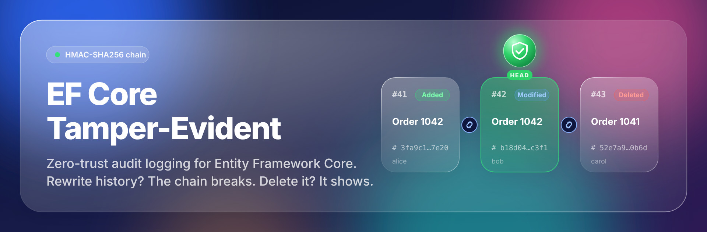
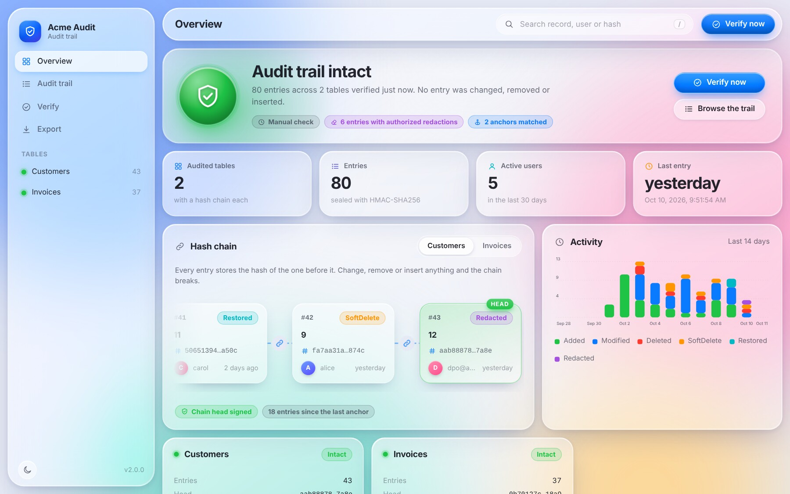
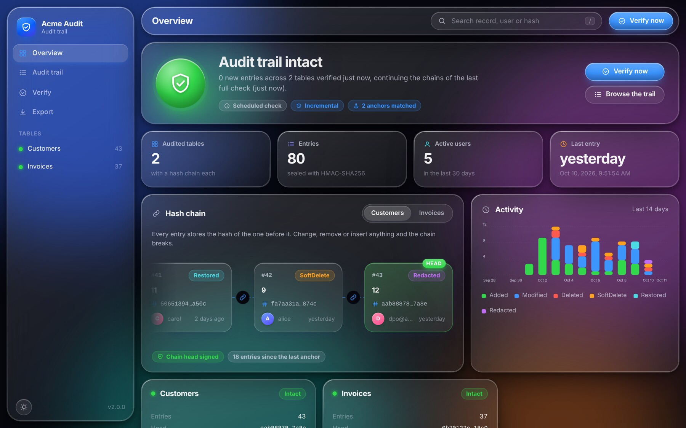
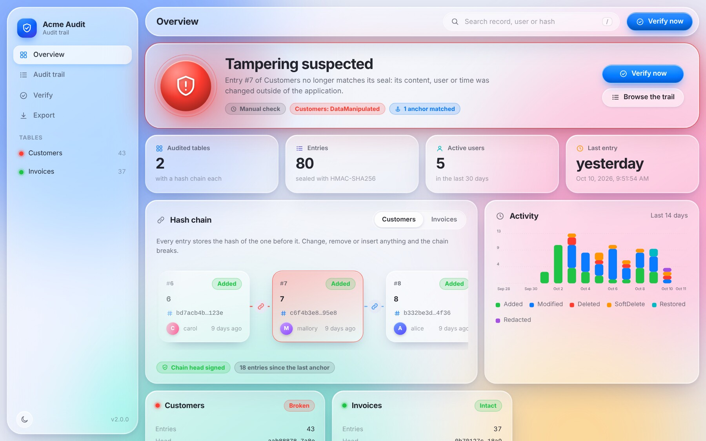
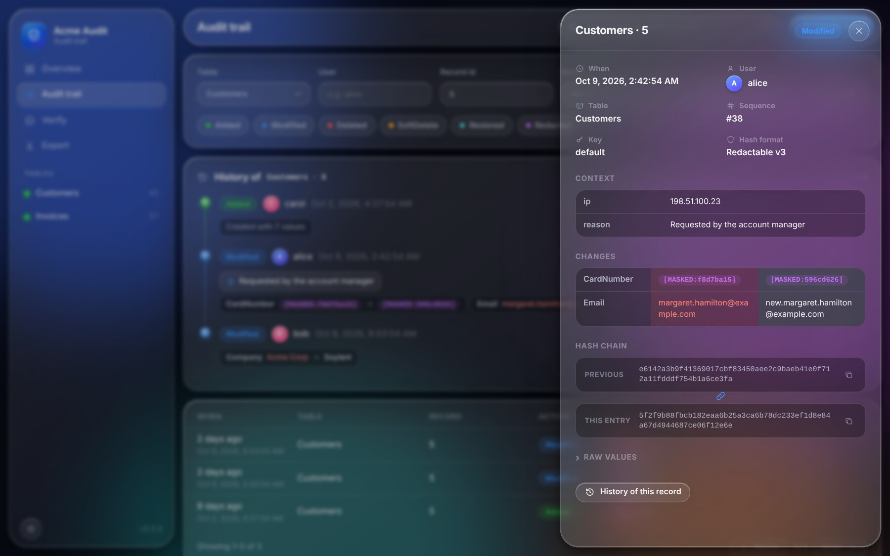
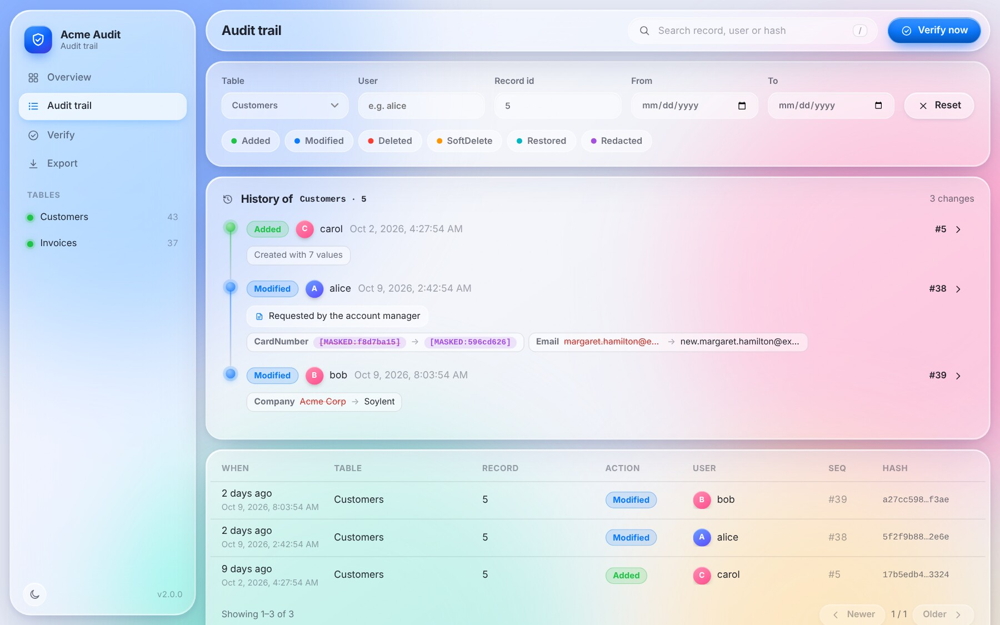
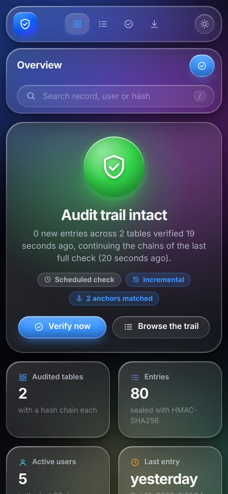
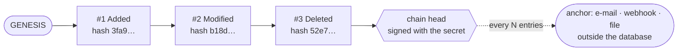

<p align="center">
  
</p>

<p align="center">
  <a href="https://www.nuget.org/packages/EfCore.TamperEvident"></a>
  <a href="https://github.com/furkiak/EfCore.TamperEvident/actions/workflows/ci.yml"></a>
  
  
  
</p>

<p align="center">
  <b>English</b> · <a href="README.tr.md">Türkçe</a>
</p>

# EF Core Tamper-Evident Audit Trail

**Zero-trust audit logging for Entity Framework Core.** Every insert, update and delete is sealed into a per-table
**HMAC-SHA256 hash chain** inside the same transaction as the change itself. Rewrite a row, delete an entry, forge an
author or cut off the newest records, and the chain stops verifying, even if the person who did it is a database
administrator with full access to the server.

It is built for systems where *"who changed what, when, why, and can we prove nobody touched the log?"* has to have an
answer: finance, healthcare, ERP/CRM, legal evidence retention, and anything that has to survive an audit. And because
personal data does not belong in an immutable log forever, entries can be **redacted for GDPR/KVKK erasure requests
without breaking the chain**.

```csharp
using (AuditScope.WithReason("Ticket #4711: corrected the billing address"))
{
    customer.City = "Ankara";
    await db.SaveChangesAsync();                 // the change and its sealed audit entry commit together
}

var report = await verifier.VerifyAllAsync();    // recomputes every seal: report.IsValid
```

<p align="center">
  
  
</p>

---

## Contents

- [What you get](#what-you-get)
- [Installation](#installation)
- [Quick start](#quick-start)
- [The dashboard](#the-dashboard)
- [How it works](#how-it-works)
- [Verifying integrity](#verifying-integrity) · [Incremental verification](#incremental-verification)
- [Anchors: protection against a rogue DBA](#anchors-protection-against-a-rogue-dba)
- [Who, why and from where](#who-why-and-from-where)
- [Sensitive data](#sensitive-data) · [GDPR/KVKK: redaction](#gdprkvkk-redaction)
- [History and time travel](#history-and-time-travel)
- [Key rotation](#key-rotation)
- [Querying and exporting](#querying-and-exporting)
- [Evidence bundles and the command line tool](#evidence-bundles-and-the-command-line-tool)
- [Observability: OpenTelemetry](#observability-opentelemetry)
- [Transactions, retries and concurrency](#transactions-retries-and-concurrency)
- [Performance](#performance)
- [Configuration reference](#configuration-reference)
- [Supported databases and frameworks](#supported-databases-and-frameworks)
- [Security model and limitations](#security-model-and-limitations)
- [Upgrading from 1.x](#upgrading-from-1x)
- [Sample application](#sample-application)
- [Contributing](#contributing) · [License](#license)

---

## What you get

| | |
|---|---|
| 🔐 **HMAC hash chain** | Each entry is linked to its predecessor and keyed with a secret. Editing, inserting, removing or reordering entries is detected. |
| 🧾 **Signed chain head** | The head of every chain is authenticated, so **deleting the newest entries** (which leaves a perfectly linked but shorter chain) is detected too. |
| 🛡 **Anchors** | Publish the chain head every *N* entries to a place the database cannot reach: e-mail, webhook, append-only file. Rewriting history inside the database then fails verification. |
| ⚛️ **Atomic and race-free** | Audit entries are written in the same transaction as the change. Concurrent writers queue on a row lock instead of forking the chain. |
| 🔁 **Works with `EnableRetryOnFailure`** | Retrying execution strategies (Azure SQL...) are supported, for `SaveChanges` and `SaveChangesAsync`. |
| 👤 **Who, why and from where** | Every change carries the user, an optional **reason**, the OpenTelemetry **trace id**, the client **IP and user agent**, and any metadata you add. All of it is part of the seal. |
| 🧽 **GDPR/KVKK redaction** | Erase personal data from old entries **without breaking the chain**: values are replaced by keyed digests, a sealed `Redacted` entry records who did it and why, and unauthorized redactions fail verification. |
| 🙈 **Sensitive data** | `[AuditIgnore]` keeps a property out of the trail, `[AuditMask]` stores a keyed fingerprint instead of the value. |
| 🕰 **History and time travel** | `GetAuditTrailAsync(entity)` returns a readable, property-by-property history; `GetStateAsOfAsync(entity, date)` rebuilds the row as it was at any moment. |
| ⚡ **Incremental verification** | Verify only what was appended since the last run: checking 100 new entries of a 10,000-entry table takes about **1.5 ms** instead of 60. |
| 📦 **Offline evidence** | Export a self-contained evidence bundle and let an auditor verify it **without access to your database**, in code or with the `tamper-evident` command line tool. |
| 📈 **OpenTelemetry** | Traces and metrics for sealing, verification, anchors and redaction, out of the box. |
| 🔑 **Key rotation** | Seal new entries with a new key while old entries stay verifiable. |
| 🧮 **Deterministic JSON** | Culture-independent, ordinally sorted, whitespace-free: the same data always produces the same bytes. |
| 🪪 **Soft delete detection** | `IsDeleted` flipping to `true` (or a `DeletedAt` date appearing) is recorded as `SoftDelete`, flipping back as `Restored`. |
| 🔎 **Query and export** | Composable queries, CSV, JSON Lines and a **court-ready evidence bundle**, all streamed. |
| 🪟 **Liquid Glass dashboard** | A beautiful single-page dashboard (ASP.NET Core package): browse, filter, follow a record through time, verify, export. Light and dark. |
| ⏱ **Scheduled verification + health check** | Incremental checks every hour and a full one every day, an alarm when something is wrong, the result on `/health`. |
| 🧪 **Tested on real servers** | The same scenarios run against SQLite, PostgreSQL, MySQL/MariaDB and SQL Server on every build. |

---

## Installation

```bash
dotnet add package EfCore.TamperEvident            # the audit trail
dotnet add package EfCore.TamperEvident.AspNetCore # dashboard, scheduled verification, health check (optional)
dotnet tool install -g EfCore.TamperEvident.Cli    # verify evidence bundles offline (optional)
```

Targets **.NET 8, .NET 9 and .NET 10** with **EF Core 8, 9 and 10**.

---

## Quick start

### 1. Add the audit tables to your model

Either call `ApplyTamperEvidentAudit()` (no properties needed, an optional schema and table names are supported)…

```csharp
public class AppDbContext(DbContextOptions<AppDbContext> options) : DbContext(options)
{
    public DbSet<Customer> Customers => Set<Customer>();

    protected override void OnModelCreating(ModelBuilder modelBuilder)
    {
        modelBuilder.ApplyTamperEvidentAudit();                // or ApplyTamperEvidentAudit(schema: "audit")
    }
}
```

…or declare the sets yourself:

```csharp
public DbSet<AuditLog> AuditLogs { get; set; }
public DbSet<AuditChainState> AuditChainStates { get; set; }
```

Then add a migration (`dotnet ef migrations add AddTamperEvident`).

### 2. Register it

```csharp
builder.Services.AddHttpContextAccessor();

builder.Services.AddTamperEvident((sp, audit) =>
{
    // Never keep the secret in source control or in the audited database: user secrets, environment variable, key vault.
    audit.HmacSecretKey = builder.Configuration["TamperEvident:SecretKey"]!;   // 32+ random characters

    audit.UseHttpContextUser(sp);                                  // attribute changes to the signed-in user (AspNetCore package)
    audit.UseHttpRequestMetadata(sp);                              // ...and record the client IP, user agent and request
    audit.AnchorThreshold = 500;                                   // publish an anchor every 500 entries per table
    audit.CustomAnchorPublisher = new FileAnchorPublisher("/mnt/worm/anchors.jsonl");
});

builder.Services.AddDbContext<AppDbContext>((sp, options) =>
    options.UseSqlServer(connectionString)                         // or UseNpgsql / UseMySql / UseSqlite
           .UseTamperEvidentAudit(sp));
```

Prefer no dependency injection? This works too:

```csharp
options.UseSqlServer(connectionString)
       .UseTamperEvidentAudit(audit => audit.HmacSecretKey = "…at least 16 characters, 32+ recommended…");
```

> **The provider is detected automatically.** There is no `DbProvider` to set any more.

### 3. Use EF Core as you always did

```csharp
db.Customers.Add(new Customer { Name = "Ada Lovelace" });
await db.SaveChangesAsync();           // SaveChanges() works as well
```

Nothing else changes. The change and its audit entry are committed together, or not at all.

### 4. See it and verify it

```csharp
builder.Services.AddTamperEvidentVerification<AppDbContext>();            // incremental every hour, full every day
builder.Services.AddHealthChecks().AddTamperEvidentHealthCheck();

app.MapTamperEvidentDashboard<AppDbContext>("/audit").RequireAuthorization("Auditors");
app.MapHealthChecks("/health");
```

---

## The dashboard

`EfCore.TamperEvident.AspNetCore` ships a self-contained dashboard in a macOS "Liquid Glass" design language:
translucent surfaces, specular edges, system typography, automatic light and dark appearance, and full keyboard
support. It needs no build step and loads **nothing from the internet**.

<p align="center">
  
</p>

| | |
|---|---|
| **Overview** | A live integrity verdict, the latest hash chain with the **broken block highlighted**, activity per day, per-table status, redactions. |
| **Audit trail** | Filter by table, action, user, record, date, hash prefix. Open any entry to see a property-by-property diff, its context (reason, IP, trace id) and its hash links. |
| **Record history** | Follow one record through time on a timeline, every change with its author and reason. |
| **Verify** | Verify one table or all of them. Paste anchor e-mails (whole messages work) to check them against the chain. |
| **Export** | CSV, JSON Lines and the evidence bundle, streamed. |

<p align="center">
  
  
</p>

<p align="center">
  
</p>

**Security by default.** The dashboard shows who changed what, so:

- Outside of the `Development` environment it **refuses to serve unless it is protected** with `RequireAuthorization(...)`
  (or you explicitly opt in with `AllowAnonymous = true`, for example behind an authenticating proxy).
- A strict Content-Security-Policy (no inline script or style, `frame-ancestors 'none'`), `no-store` API responses
  and an anti-CSRF header on every state-changing request.
- Exports can be switched off (`AllowExport = false`).

```csharp
app.MapTamperEvidentDashboard<AppDbContext>("/audit", options =>
{
    options.Title = "Acme Audit";
    options.AnchorProvider = AnchorSources.FromFile("/mnt/worm/anchors.jsonl");   // verify against the stored anchors
}).RequireAuthorization("Auditors");
```

---

## How it works



Every table has its own chain. An entry stores:

| Field | |
|---|---|
| `TableName`, `RecordId` | What was changed. Composite keys are joined with `\|`. |
| `ActionType` | `Added`, `Modified`, `Deleted`, `SoftDelete`, `Restored` (or `Redacted`, see [redaction](#gdprkvkk-redaction)). |
| `OldValues`, `NewValues` | Deterministic JSON. Updates only contain the properties that changed. Inserts contain the keys and defaults generated by the database. |
| `UserId`, `Metadata` | Who did it, and why and from where (reason, trace id, IP, your own entries) as JSON. |
| `KeyId`, `HashVersion` | Which secret sealed the entry, and in which format. |
| `SequenceNumber`, `TimestampTicks` | The position in the chain (authoritative) and the application clock (informative). |
| `PreviousHash`, `CurrentHash` | `CurrentHash = HMAC-SHA256(secret, every field above, length-prefixed)`. |

Values are not hashed directly: every value, the record id and the user are committed through their own keyed digest,
salted with the entry id. That is what lets a value be [redacted](#gdprkvkk-redaction) later while the seal stays valid,
and it keeps the digest of a redacted value from being guessed or matched across entries.

The head of the chain (`AuditChainStates`) holds the newest hash and sequence number together with an HMAC over both.

**Two phases, one transaction.** `SavingChanges` captures what is about to change and makes sure a transaction exists.
After the database wrote the data (and generated its keys) `SavedChanges` locks the chain head
(`SELECT … FOR UPDATE` / `UPDLOCK`), appends the new entries, advances the signed head and commits.
If anything fails, everything is rolled back.

---

## Verifying integrity

```csharp
var verifier = new AuditVerifier(db, options);              // or inject it: services.AddTamperEvidentVerifier<AppDbContext>()

AuditVerificationResult result = await verifier.VerifyTableIntegrityAsync("Customers", anchorHashes);
if (!result.IsValid)
{
    // result.Failure:        DataManipulated, ChainBroken, RecordsMissing, AnchorMismatch, ...
    // result.FailedSequence: the first entry that does not check out
    logger.LogCritical("TAMPERING: {Message}", result.Message);
}

AuditVerificationReport report = await verifier.VerifyAllAsync();   // every audited table
```

A verification checks, for every table:

1. **Every link:** each entry points to the hash of its predecessor, and sequence numbers are consecutive.
2. **Every hash:** all fields (including the user, the metadata and the timestamp) are recomputed with the secret.
3. **The chain head:** its signature is valid and it matches the newest entry. Deleted tails are caught here.
4. **Entries behind the head:** rows that were inserted without going through the interceptor.
5. **Your anchors:** every hash you provide must still occur in the chain.
6. **Redactions:** every redacted value must be authorized by a sealed `Redacted` entry that comes after it.

| `AuditFailureKind` | Meaning |
|---|---|
| `DataManipulated` | An entry no longer matches its seal (content, user, time, key). |
| `ChainBroken` / `SequenceGap` | An entry was removed, inserted or reordered. |
| `RecordsMissing` | The newest entries were deleted. |
| `RecordsBeyondHead` | Entries exist that were never written by the audit trail. |
| `ChainStateTampered` / `ChainStateMissing` | The signed head was edited, un-signed or deleted. |
| `UnknownKey` | An entry was sealed with a key you did not configure. |
| `AnchorMismatch` | An anchor stored elsewhere no longer occurs: the history was rewritten. |
| `UnauthorizedRedaction` | A value was replaced by a redaction marker without a sealed `Redacted` entry that authorizes it. |
| `CheckpointMismatch` | The entry an incremental verification starts from was changed or removed. |

Verification streams the table and never loads it into memory. It reads the next batch while the current one is hashed on
all cores, and it is safe to run while the application writes.

### Incremental verification

Every successful result carries a `Checkpoint`. Verify from it next time and only the entries appended since are read:

```csharp
var first = await verifier.VerifyTableIntegrityAsync("Orders");                 // full: reads every entry
// ... later ...
var next = await verifier.VerifyFromCheckpointAsync(first.Checkpoint!);         // reads only what is new

var report = await verifier.VerifyAllAsync(anchors, previousReport.Checkpoints); // every table, incrementally
```

An incremental run proves that the new entries are authentic and correctly linked to the checkpoint, that the checkpoint entry
is still in place, unchanged, and that the signed head matches. Changes to the *content* of older entries are found by a full
verification, so keep checkpoints out of the database's reach (in memory, or in another store) and run a full verification
regularly. `AddTamperEvidentVerification` does exactly that: incremental runs on every `Interval`, a full run every
`FullVerificationInterval` (24 hours by default).

---

## Anchors: protection against a rogue DBA

A hash chain inside the database proves integrity **only as long as the secret is safe**. If someone obtains the secret
*and* controls the database, they can rebuild a perfectly consistent, forged chain. Anchors close that gap: every
`AnchorThreshold` entries the current chain head is sent somewhere the database administrator cannot rewrite. A forged
history no longer contains the anchored hash, and verification fails with `AnchorMismatch`.

| Publisher | Use it for |
|---|---|
| `SmtpAnchorPublisher` | A mailbox the DBAs cannot access (configure `SmtpHost`, `SmtpUser`, `AnchorEmailTo`). |
| `WebhookAnchorPublisher` | A SIEM, a Slack/Teams relay or an append-only ledger. Optional signature header, see below. |
| `FileAnchorPublisher` | An append-only file on WORM storage or another server. Read it back with `AnchorSources.FromFile`. |
| `CompositeAnchorPublisher` | Several of the above; each target is retried on its own. |
| your own `IAnchorPublisher` | Implement `PublishAsync`. 1.x implementations (`SendAnchorAsync`) keep working. |

Anchors are only sent **after the audited transaction committed** (and are dropped if it rolls back). Delivery happens
in the background with retries (`AnchorMaxAttempts`, `AnchorRetryDelay`); call `interceptor.FlushAnchorsAsync()` on shutdown or set
`AwaitAnchorDelivery`. A failing publisher never fails `SaveChanges`.

**Signed webhooks.** With a signing secret, every request carries
`X-TamperEvident-Signature: t=<unix time>,v1=<hex HMAC-SHA256 of "<unix time>." + body>`. The time is signed too, so a captured
request cannot be replayed later. Receivers check it in one line:

```csharp
app.MapPost("/anchors", async (HttpRequest request) =>
{
    using var body = new MemoryStream();
    await request.Body.CopyToAsync(body);
    if (!WebhookAnchorPublisher.VerifySignature(
            request.Headers[WebhookAnchorPublisher.SignatureHeader], body.ToArray(), signingSecret))
    {
        return Results.Unauthorized();                   // forged, altered, or older than five minutes
    }

    // store the anchor somewhere the database administrators cannot reach
    return Results.Ok();
});
```

---

## Who, why and from where

```csharp
// ASP.NET Core: the authenticated user of the request ("anonymous" for visitors, "System" outside of requests)
audit.UseHttpContextUser(sp);                                   // or ...(sp, principal => principal.FindFirst("email")?.Value)

// Background jobs, imports, migrations
using (AuditScope.Begin("job:nightly-import"))
{
    await db.SaveChangesAsync();
}

// Anything else
audit.UserIdProvider = db => currentUserService.UserId;
```

**Reasons and metadata.** Auditors rarely ask only *who*; they ask *why*. Give a reason, or any other context, and it is sealed into
every entry written inside the scope:

```csharp
using (AuditScope.Begin("support:mehmet", reason: "Ticket #4711: customer asked to close the account"))
using (AuditScope.WithMetadata("ticket", 4711))
{
    db.Accounts.Remove(account);
    await db.SaveChangesAsync();
}

audit.MetadataProvider = db => new Dictionary<string, object?> { ["tenant"] = tenantContext.TenantId };   // on every save
audit.UseHttpRequestMetadata(sp);       // ip, userAgent and "POST /orders/42" (never the query string)
```

The W3C trace id of the current `Activity` is recorded as `traceId` (`CaptureTraceId`), so an audit entry leads straight to the
distributed trace of the request that made the change. The user and the metadata are part of the seal: rewriting them is detected.

---

## Sensitive data

```csharp
public class Customer
{
    public int Id { get; set; }
    public string Name { get; set; } = "";

    [AuditIgnore] public string? PasswordHash { get; set; }     // never copied into the trail
    [AuditMask]   public string? CardNumber { get; set; }       // "[MASKED:1a2b3c4d]": a keyed fingerprint
}

[AuditIgnore] public class ScratchPad { … }                      // the whole entity is not audited
```

Or configure it centrally: `audit.ExcludedTables`, `audit.ExcludedProperties`, `audit.MaskedProperties`.
A masked value still proves **that** it changed (the fingerprint changes), without storing **what** it was.

---

## GDPR/KVKK: redaction

An immutable log and the right to erasure seem to contradict each other. Here they do not: personal data can be removed from
the audit trail while every seal, the chain, its signed head and every anchor already sent out stay valid.

```csharp
// Erase what the trail knows about one customer, but keep the fact that the changes happened
await db.RedactAuditTrailAsync(customer, new AuditRedactionRequest
{
    Reason = "Erasure request #4711 (GDPR Art. 17)",
    Properties = ["Name", "Email", "Phone"],          // or AuditRedactionRequest.All
    MetadataKeys = ["ip", "userAgent"],
    RedactRecordId = false                            // true when the key itself is personal (an e-mail address)
});

await db.RedactAuditUserAsync("former.employee@acme.com", "Left the company, request #12");   // every table

await db.RedactAuditEntriesAsync(                                                               // a retention policy
    db.AuditLogs().ForTable("Visitors").Between(null, DateTimeOffset.UtcNow.AddYears(-2)),
    new AuditRedactionRequest { Reason = "Two-year retention", MetadataKeys = [AuditRedactionRequest.All] });
```

How it stays verifiable:

- A redacted value is replaced by its keyed digest (`{"$redacted":"…"}`), which is exactly what the seal commits to.
  The hash of the entry does not change, so nothing downstream of it changes either.
- The digest is salted with the entry id and keyed with your secret: it cannot be used to guess the value or to find other
  entries with the same value.
- Every redaction appends a sealed **`Redacted` entry** to the chain: who redacted which entries and fields, and why.
  The redaction itself is audited.
- Verification accepts a redacted value only when such a later entry authorizes it. Wiping values directly in the database
  is reported as `UnauthorizedRedaction`, and values that look like redaction markers are refused when an entry is written.

Entries written before 2.0 cannot be redacted without breaking their seal; they are reported in `NotRedactable` and left untouched.
The history API, the exports and the dashboard show redacted values as such.

---

## History and time travel

```csharp
foreach (var change in await db.GetAuditTrailAsync(order))                   // oldest first
{
    Console.WriteLine($"{change.TimestampUtc:u} {change.UserId} {change.Action} {change.Reason}");
    foreach (var p in change.Changes)
        Console.WriteLine($"    {p.Property}: {p.OldValue} → {p.NewValue}");
}

var snapshot = await db.GetStateAsOfAsync(order, new DateTimeOffset(2026, 3, 1, 0, 0, 0, TimeSpan.Zero));
Order? asItWas = snapshot.ToObject<Order>();                                  // null if it did not exist yet
```

`AuditValue` tells a real value apart from a masked or redacted one, and works with entities that have been deleted since
(pass the table name and the record id instead of the entity).

---

## Key rotation

```csharp
audit.HmacSecretKey = newSecret;
audit.HmacKeyId = "2027";
audit.AdditionalHmacKeys["2026"] = oldSecret;       // retired: only used to verify older entries
```

New entries are sealed with the new key, old ones stay verifiable. Entries without a key id are verified against every
configured key.

---

## Querying and exporting

```csharp
var history = await db.GetAuditHistoryAsync(customer);                        // the raw entries of one entity, oldest first

var recent = await db.AuditLogs()                                              // composable IQueryable<AuditLog>
    .ForTable("Customers").ByUser("alice").OfAction(AuditActions.Deleted)
    .Between(DateTimeOffset.UtcNow.AddDays(-7), null).Newest().Take(50).ToListAsync();

await AuditExporter.WriteCsvAsync(stream, db.AuditLogs().ForTable("Customers").InChainOrder());
await AuditExporter.WriteJsonLinesAsync(stream, db.AuditLogs().InChainOrder());
await AuditExporter.WriteEvidenceBundleAsync(stream, db, verifier);           // see below
```

CSV cells that a spreadsheet could read as a formula (`=`, `+`, `-`, `@`) are neutralised.

---

## Evidence bundles and the command line tool

An evidence bundle is a single JSON document an auditor, a court or a regulator can check **without access to your database**:
every table's signed chain head, the verification result and every entry in chain order, taken from one consistent snapshot.

```csharp
await using var file = File.Create("evidence-2026-10.json");
await AuditExporter.WriteEvidenceBundleAsync(file, db, verifier);              // or the Export page of the dashboard

// Later, anywhere: the secret is needed, the database is not
await using var bundle = File.OpenRead("evidence-2026-10.json");
AuditVerificationReport report = await AuditEvidence.VerifyBundleAsync(bundle, options, anchors);
```

Or with the .NET tool:

```bash
dotnet tool install -g EfCore.TamperEvident.Cli

export TAMPER_EVIDENT_KEY='…'                                   # never on the command line
tamper-evident verify evidence-2026-10.json --anchors anchors.jsonl
tamper-evident verify evidence-2026-10.json --key-file /run/secrets/audit-key --json
tamper-evident inspect evidence-2026-10.json                    # summary, without verifying
tamper-evident keygen                                           # a new random secret
```

`verify` exits with `0` when everything is intact, `1` when tampering was detected and `2` on invalid input, so it drops into
scripts and pipelines. Bundles are read as a stream: their size is not limited by memory. `--anchors` accepts anchor files
(`FileAnchorPublisher`) and any text that contains the hashes, such as saved anchor e-mails; `--retired-key id=env:VAR` adds retired keys.

---

## Observability: OpenTelemetry

```csharp
builder.Services.AddOpenTelemetry()
    .WithTracing(t => t.AddSource(TamperEvidentTelemetry.SourceName))
    .WithMetrics(m => m.AddMeter(TamperEvidentTelemetry.SourceName));
```

| | |
|---|---|
| **Activities** | `tamper_evident.seal`, `tamper_evident.verify`, `tamper_evident.redact`, `tamper_evident.anchor.publish` |
| **Metrics** | `tamper_evident.entries.sealed`, `tamper_evident.seal.duration`, `tamper_evident.verifications` (by result), `tamper_evident.entries.verified`, `tamper_evident.verification.duration`, `tamper_evident.anchors.published`, `tamper_evident.values.redacted` |
| **Tags** | `tamper_evident.table`, `tamper_evident.entries`, `tamper_evident.result`, `tamper_evident.incremental` |

Alert on `tamper_evident.verifications` with a result other than `valid`, and you know about tampering within one verification interval.

---

## Transactions, retries and concurrency

- **Your transaction is respected.** If you call `BeginTransaction`, the audit entries join it and are committed or
  rolled back with it; the interceptor never commits a transaction it did not start. `TransactionScope` is supported.
- **Retrying execution strategies work.** With `EnableRetryOnFailure()` the whole save, its transaction included, runs as
  one retriable unit. (`SaveChanges(acceptAllChangesOnSuccess: false)` is not supported in that mode.)
- **Concurrent writers never fork a chain.** They serialize on the chain head row, tables are locked in a fixed order so
  that writers of several tables cannot deadlock, and a unique index on `(TableName, PreviousHash)` refuses a fork even if
  locking were bypassed. The chain head of a new table is created race-free.
- **If writing the audit entry fails**, the change is not persisted and an `AuditTrailException` is thrown (a non-transient
  exception, so a retrying strategy cannot re-run a save that was already accepted). Discard the `DbContext` and repeat the operation.
- Saving a table that is **excluded** or has nothing to audit never opens a transaction.

| Database | Chain head lock | New chain head |
|---|---|---|
| SQL Server | `WITH (UPDLOCK, ROWLOCK)` | `INSERT … WHERE NOT EXISTS (… WITH (UPDLOCK, HOLDLOCK))`, duplicate key ignored |
| PostgreSQL | `FOR UPDATE` | `INSERT … ON CONFLICT DO NOTHING` |
| MySQL / MariaDB | `FOR UPDATE` | `INSERT IGNORE` (before the transaction, to avoid InnoDB gap-lock deadlocks) |
| SQLite | the transaction's write lock | `INSERT OR IGNORE` |
| In-memory | none (unit tests only) | change tracker |

Table and column names, schemas and naming conventions (for example snake_case) are read from your EF Core model.
The audit statements are prepared once per model, use the column types of the model, and still run through EF Core's
logging, diagnostics and your own command interceptors.

---

## Performance

Sealing happens in the same transaction as your change, so its cost is a few extra statements per save, not per entity:
the chain heads are locked with one statement, and the new entries and the advanced chain heads are written with one more.
Everything that can be cached per entity type (which properties are audited, masked or ignored, their names, key accessors)
is, and serialization and hashing run on pooled buffers.

Measured with the [benchmark project](benchmarks/EfCore.TamperEvident.Benchmarks) on .NET 10 (a 4-core cloud VM; a `Customer`
with eight properties; PostgreSQL 16 in a local container, SQLite in memory):

| One `SaveChanges` | no audit | audited |
|---|---:|---:|
| PostgreSQL, insert 1 row | 1.3 ms | 3.5 ms |
| PostgreSQL, insert 100 rows | 5.9 ms | 14.0 ms |
| SQLite, insert 1 row | 0.08 ms | 0.33 ms |
| SQLite, insert 100 rows | 2.5 ms | 12.5 ms |

| Verification (SQLite, a table with 10,000 entries) | |
|---|---:|
| Full: every entry recomputed and every link checked | 59 ms |
| Incremental: 100 new entries | 1.5 ms |

The cost of an audited save is mostly the database writing the audit rows and their indexes; the library's own work per entry
(serializing, sealing) is a few microseconds. Verification recomputes about 170,000 entries per second.

```bash
dotnet run -c Release --project benchmarks/EfCore.TamperEvident.Benchmarks -- --filter '*'
TE_BENCH_POSTGRES="Host=…;Username=…;Password=…" dotnet run -c Release --project benchmarks/EfCore.TamperEvident.Benchmarks -- --filter '*Postgres*'
```

---

## Configuration reference

All settings live on `TamperEvidentOptions`.

| Option | Default | |
|---|---|---|
| `HmacSecretKey` | **required** | The secret. At least 16 characters, 32+ recommended. The 1.x default key is refused. |
| `HmacKeyId` | `null` | Identifies the current secret (for [rotation](#key-rotation)). |
| `AdditionalHmacKeys` | empty | Retired secrets, keyed by id, used for verification only. |
| `TrackedOperations` | `All` | `Insert`, `Update`, `Delete` flags. |
| `ExcludedTables` | empty | Table names that are never audited (case-insensitive). |
| `ExcludedProperties` / `MaskedProperties` | empty | Property names that are dropped / replaced by a fingerprint, on every entity. |
| `SoftDeleteColumnName` | `IsDeleted` | A `bool` flipping to `true`, or a nullable date getting a value, is recorded as `SoftDelete`. |
| `UserIdProvider` | `null` | Resolves the user once per save. An `AuditScope` takes precedence. |
| `DefaultUserId` | `System` | Used when no user can be resolved. |
| `MetadataProvider` | `null` | Metadata sealed into every entry of a save (`AuditScope` metadata wins on conflicts). |
| `CaptureTraceId` | `true` | Records the W3C trace id of the current `Activity` as `traceId`. |
| `AnchorThreshold` | `1000` | Entries per table between two anchors. `0` disables anchoring. |
| `CustomAnchorPublisher` | `null` | Where anchors go. Falls back to the SMTP settings. |
| `AnchorMaxAttempts` / `AnchorRetryDelay` | `3` / 2 s | Retry policy (the delay doubles). |
| `AwaitAnchorDelivery` | `false` | Wait for the publisher instead of delivering in the background. |
| `SmtpHost`, `SmtpPort`, `SmtpEnableSsl`, `SmtpUser`, `SmtpPassword`, `AnchorEmailTo` | | Built-in e-mail publisher. |
| `DbProvider` | `Auto` | Only set it to override the provider detection. |
| `TimeProvider` | `TimeProvider.System` | The clock. Replace it in tests. |
| `LoggerFactory` | from EF Core | Used for anchor delivery logs. |

The options are validated when the audit is registered, so a missing or weak secret fails at start-up, not in production.

**ASP.NET Core package**

| Setting | Default | |
|---|---|---|
| `UseHttpContextUser(sp, selector?)` | | The signed-in user of the request. |
| `UseHttpRequestMetadata(sp, o => …)` | `IpAddress`, `UserAgent`, `Request` on; `RequestId` off | Where the change came from. |
| `AddTamperEvidentVerification<T>(o => …)` | `Interval` 1 h, `InitialDelay` 1 min | Scheduled verification. `OnTamperDetected` raises your alarm, `AnchorProvider` supplies the anchors. |
| ↳ `Incremental` / `FullVerificationInterval` | `true` / 24 h | Incremental runs in between full ones. |
| `MapTamperEvidentDashboard<T>(path, o => …)` | | `Title`, `AllowAnonymous` (`false`), `AllowExport` (`true`), `AnchorProvider`, `MaxPageSize` (200). |

---

## Supported databases and frameworks

| Database | Provider | Status |
|---|---|---|
| SQL Server | `Microsoft.EntityFrameworkCore.SqlServer` | ✅ conformance tests in CI |
| PostgreSQL | `Npgsql.EntityFrameworkCore.PostgreSQL` | ✅ conformance tests in CI |
| MySQL / MariaDB | `Pomelo.EntityFrameworkCore.MySql` | ✅ conformance tests in CI (MySQL 8.4, MariaDB 10.11) |
| SQLite | `Microsoft.EntityFrameworkCore.Sqlite` | ✅ |
| In-memory | `Microsoft.EntityFrameworkCore.InMemory` | ✅ for unit tests of your own code (no transactions, no locks) |

| EF Core | .NET | |
|---|---|---|
| 8.0 | .NET 8 | ✅ |
| 9.0 | .NET 9 | ✅ |
| 10.0 | .NET 10 | ✅ |

---

## Security model and limitations

This library provides **tamper evidence**, not tamper prevention. A user with enough privileges can still change the
data, but doing so becomes cryptographically detectable.

**It detects:** edited, deleted, inserted or reordered entries; a rewritten author, reason or timestamp; removed newest entries;
a forged or un-signed chain head; values wiped without an authorized redaction; and (with anchors) a complete rebuild of the history.

**Know the limits:**

- **The secret is the root of trust.** Whoever holds it can forge a consistent chain. Keep it out of the database
  and the source code, and use anchors so that a stolen secret alone is not enough.
- **Anchors are what stop a rewrite by someone who knows the secret.** Without them, restoring an older consistent
  snapshot of the tables (entries and signed head together) is undetectable.
- **Only changes made through `SaveChanges` are audited.** `ExecuteUpdate`, `ExecuteDelete`, raw SQL and changes made
  outside EF Core are not. Entries added directly to the audit tables are caught by verification.
- **A failed audit write leaves the `DbContext` in an inconsistent state** (EF already accepted the entities, the database
  rolled back). Dispose it, as after any failed save.
- **Incremental verification trusts its checkpoint.** It does not re-read older entries; keep checkpoints out of the
  database's reach and run full verifications regularly (the scheduled verification does).
- **Redaction is deliberate erasure.** Someone who holds the secret and can write to the database can redact values and
  append a valid `Redacted` entry; the redaction is then visible in the chain, but the original values are gone. Restrict
  who can call the redaction API, and use anchors.
- Timestamps come from the application clock; the **sequence number** defines the order.

---

## Upgrading from 1.x

2.0 fixes several serious problems of 1.x and is a **major** release with a schema change.

**Why upgrade**

- `SaveChanges()` (synchronous) was **never audited**. It is now.
- Saving only excluded tables left a transaction open and **the data was never committed**.
- The interceptor **committed the caller's own transaction**; the user, the key and the field boundaries were not part of the hash;
  deleting the newest entries went unnoticed; the default HMAC key was public; `EnableRetryOnFailure` was unsupported;
  anchor e-mails reported `0` records; JSON key order depended on the culture (`tr-TR`!); entity graphs with navigation cycles crashed.

**Steps**

1. Update the package and **configure a real `HmacSecretKey`** (the old default is refused). If you used the default key until now,
   keep it only to verify your existing entries:
   ```csharp
   audit.HmacSecretKey = newSecret;
   audit.AdditionalHmacKeys["v1"] = TamperEvidentOptions.Version1DefaultKey;
   ```
2. Add a migration. New columns: `AuditLogs.SequenceNumber`, `HashVersion`, `KeyId`, `Metadata`; `AuditChainStates.LastSequence`, `KeyId`, `Mac`;
   new indexes, including the unique `(TableName, PreviousHash)`; `AuditLogs.RecordId` is limited to 256 characters (`TableName` 128, `UserId` 256).
3. Existing entries keep working: they are verified in their original format and the chain continues behind them
   with entries in the new format (`HashVersion = 3`). The chain head is signed with the first new write.
   Only entries written by 2.0 can be [redacted](#gdprkvkk-redaction).
4. Remove `DbProvider`: it is detected automatically. `SecurityHelper.GetLockQuery` is gone; `AuditVerifier.VerifyTableIntegrityAsync`
   now returns an `AuditVerificationResult` (`var (isValid, message) = …` still works).

See the [changelog](CHANGELOG.md) for the full list.

---

## Sample application

`samples/QuickStart` is a runnable ASP.NET Core app with SQLite, ten days of demo history (with reasons, request metadata and a
GDPR redaction), cookie sign-in, anchors in a file, scheduled verification, a health check and the dashboard. It even contains
an endpoint that plays the rogue DBA.

```bash
dotnet run --project samples/QuickStart
# open http://localhost:5000/login/alice  (then /audit)
# POST http://localhost:5000/demo/tamper  → run a verification and watch the dashboard turn red
```

---

## Contributing

Issues and pull requests are welcome. Please open an issue before large architectural changes.
`dotnet test` runs the unit suites; the provider conformance tests need the connection strings described in
[`EfCore.TamperEvident.IntegrationTests`](EfCore.TamperEvident.IntegrationTests/EfCore.TamperEvident.IntegrationTests.csproj)
(CI starts the servers for you). Security issues: see [SECURITY.md](SECURITY.md).

## License

Licensed under the **MIT License**.
