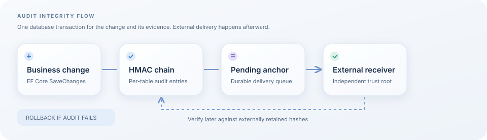

# EF Core Tamper-Evident

An EF Core audit trail that links row changes with HMAC-SHA256 and can export periodic hashes to a separate trust boundary. It records inserts, updates and deletes on both `SaveChanges()` and `SaveChangesAsync()`, including database-generated primary keys.



> **Release status:** this branch is the **unpublished 2.0.0 preview**. NuGet 1.0.1 uses a different hash and configuration format. Do not apply this branch to an existing 1.x audit database without a reviewed migration. SQL Server has real integration coverage; PostgreSQL and MySQL are not yet integration-verified.

## Why it exists

Ordinary application logs can be edited along with the records they describe. This library places each audit entry in a per-table chain:

```text
business row -> audit entry -> HMAC(previous hash + complete audit identity and payload)
                                     |
                             next audit entry
                                     |
                           pending external anchor
```

The HMAC covers the audit ID, table, composite record key, action, old and new values, actor, timestamp and previous hash. Fields are length-framed so two different records cannot hash to the same byte sequence by ambiguous concatenation. When an anchor is delivered and retained outside the database, a verifier can detect a rewritten or truncated chain relative to that trusted anchor.

This is **tamper evidence**, not a guarantee that the database cannot be changed. The protection depends on an application-held secret that database administrators cannot read and on independently retained external anchors. Verification without external anchors cannot prove that the whole history was not replaced by someone who also has the HMAC key. The audit payload is plaintext: configure access control, retention and redaction for your data.

## Requirements

- .NET 9, EF Core 9 and a relational EF provider
- A base64-encoded, randomly generated HMAC key of at least 32 bytes, stored outside source control and outside the audited database
- Three mapped tables: `AuditLogs`, `AuditChainStates` and `PendingAnchors`
- A scheduled call to `AnchorDispatcher` if external anchoring is enabled

Generate a key once with `RandomNumberGenerator.GetBytes(32)`, convert it with `Convert.ToBase64String`, and store it in a production secret manager. Do not rotate it without preserving the previous key and a verified migration strategy: existing hashes require the original key.

## Quick start

Build the unpublished preview locally with `dotnet pack -c Release`. For the published 1.0.1 package, use its matching tag and documentation.

```csharp
using EfCore.TamperEvident.Extensions;
using EfCore.TamperEvident.Models;
using Microsoft.EntityFrameworkCore;

public sealed class AppDbContext(DbContextOptions<AppDbContext> options) : DbContext(options)
{
    public DbSet<Customer> Customers => Set<Customer>();

    protected override void OnModelCreating(ModelBuilder builder)
    {
        base.OnModelCreating(builder);
        builder.AddTamperEvidentModels();
    }
}
```

```csharp
builder.Services.AddDbContext<AppDbContext>((services, options) =>
{
    options.UseSqlServer(builder.Configuration.GetConnectionString("App"));
    options.UseTamperEvidentAudit(audit =>
    {
        audit.HmacSecretKey = builder.Configuration["Audit:HmacKey"]
            ?? throw new InvalidOperationException("Audit:HmacKey is missing");
        audit.AnchorThreshold = 500;
        audit.UserIdProvider = _ => services
            .GetRequiredService<IHttpContextAccessor>()
            .HttpContext?.User.Identity?.Name ?? "System";
    });
});
```

Add `IHttpContextAccessor` if you use this actor example, generate an EF migration, review it, and apply it before writing audited entities. The library deliberately fails when audit models or the key are missing. A change and its audit entries are written in one transaction; an audit failure rolls back the business change. If the caller owns the transaction, the library leaves a successful transaction open for the caller. On an audit failure, it rolls back even that caller-owned transaction to prevent an unaudited commit. Use a fresh `DbContext` after a rolled-back transaction.

The package redacts common secret-named properties such as `Password`, `ApiKey` and `Token` in old/new snapshots. Extend `RedactedProperties` for your domain. Record IDs, actor IDs and other properties can still contain personal data; review your schema before enabling an audit trail.

## External anchors

Reaching `AnchorThreshold` persists a `PendingAnchor` in the **same** transaction as the business row and audit entries. It does not claim that email was sent. Run this after commits, for example in a hosted background job using a fresh context:

```csharp
var auditOptions = new TamperEvidentOptions
{
    HmacSecretKey = secretFromYourSecretManager,
    SmtpHost = smtpHost,
    SmtpUser = smtpUser,
    SmtpPassword = smtpPassword,
    AnchorEmailTo = externalMailbox
};
var sent = await new AnchorDispatcher(dbContext, auditOptions)
    .DispatchPendingAsync(cancellationToken: stoppingToken);
```

You can inject an `IAnchorPublisher` via `CustomAnchorPublisher` instead of SMTP. Delivery errors leave anchors pending for retry. Delivery is at least once, so your external receiver should tolerate duplicate hashes. Keep the receiver and its retained messages outside the audited database's administrative boundary. Monitor pending age and failures: a queued hash alone does not protect against a full database rewrite.

To verify, obtain hashes from that external receiver in **chain order** and pass them to `AuditVerifier.VerifyTableIntegrityAsync(tableName, externalHashes)`. The verifier does not alter the supplied list; missing, extra or out-of-order hashes fail verification. An empty audit history is **inconclusive**, and a missing or mismatched chain state or external anchor is a failure. A v1 chain is rejected by the v2 verifier until an explicit migration is designed and reviewed.

## Test and support status

```powershell
dotnet test --filter 'Category!=SqlServer'
$env:EFCORE_AUDIT_SQLSERVER='Server=.\SQLEXPRESS;Integrated Security=true;TrustServerCertificate=true'
dotnet test
```

The first command runs portable unit tests; the second additionally creates and deletes uniquely named `AuditIt_*` databases on your **test** SQL Server. It checks sync/async saves, failure rollback, caller-owned transactions, concurrent writers, verification and anchor retries. Do not point this environment variable at production.

SQL Server uses transaction-scoped `sp_getapplock` plus a chain-row update lock. PostgreSQL and MySQL have provider-specific row-lock queries but lack integration coverage here; treat them as experimental and validate their transaction and concurrent first-row behavior before use. EF Core's implicitly retrying execution strategy requires its documented user-transaction pattern and is not covered by the current integration tests.

## Upgrade and threat-model notes

- **1.x → 2.0 preview is breaking.** v2 requires a base64 key, adds `PendingAnchors` and `LastTimestampTicks`, and changes hash inputs. Keep 1.x data and external anchors intact. Do not reset or delete a production audit chain to make it pass the v2 verifier.
- A person with the HMAC key can forge a chain; rotate exposed keys and investigate under a documented incident process. The old public default key must never be reused.
- External anchor delivery is a separate trust boundary and can fail. Retention, access control, backup, monitoring and independent verification remain operational responsibilities.
- Raw SQL, bulk updates, direct database writes and changes outside EF `SaveChanges` bypass interceptors. Route relevant writes through the audited context or design a database-level control.
- `AuditLogs` contains old and new values. Restrict reads and configure redaction before using it with sensitive records.

Contributions and reproducible issues are welcome. Licensed under [MIT](LICENSE).
