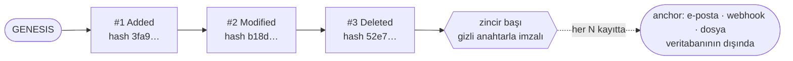

<p align="center">
  
</p>

<p align="center">
  <a href="https://www.nuget.org/packages/EfCore.TamperEvident"></a>
  <a href="https://github.com/furkiak/EfCore.TamperEvident/actions/workflows/ci.yml"></a>
  
  
  
</p>

<p align="center">
  <a href="README.md">English</a> · <b>Türkçe</b>
</p>

# EF Core Tamper-Evident Denetim İzi

**Entity Framework Core için sıfır-güven (zero-trust) denetim kaydı.** Her ekleme, güncelleme ve silme işlemi,
değişikliğin kendisiyle **aynı transaction içinde** tablo başına bir **HMAC-SHA256 hash zincirine** mühürlenir.
Bir satırı yeniden yazarsanız, bir kaydı silerseniz, yazarı (kullanıcıyı) değiştirirseniz ya da en yeni kayıtları
kesip atarsanız zincir doğrulanmaz olur; bunu yapan kişi sunucuya tam erişimi olan bir veritabanı yöneticisi (DBA) olsa bile.

*"Kim neyi değiştirdi ve bu kayda kimsenin dokunmadığını kanıtlayabilir miyiz?"* sorusunun cevabı gereken sistemler için
tasarlandı: finans, sağlık, ERP/CRM, hukuki delil saklama ve denetimden geçmesi gereken her şey.

<p align="center">
  
  
</p>

---

## İçindekiler

- [Neler sunar](#neler-sunar)
- [Kurulum](#kurulum)
- [Hızlı başlangıç](#hızlı-başlangıç)
- [Pano (dashboard)](#pano-dashboard)
- [Nasıl çalışır](#nasıl-çalışır)
- [Bütünlüğü doğrulama](#bütünlüğü-doğrulama)
- [Anchor'lar: kötü niyetli DBA'ya karşı koruma](#anchorlar-kötü-niyetli-dbaya-karşı-koruma)
- [Kullanıcı atfı](#kullanıcı-atfı)
- [Hassas veri](#hassas-veri)
- [Anahtar rotasyonu](#anahtar-rotasyonu)
- [Sorgulama ve dışa aktarma](#sorgulama-ve-dışa-aktarma)
- [Transaction, yeniden deneme ve eşzamanlılık](#transaction-yeniden-deneme-ve-eşzamanlılık)
- [Yapılandırma başvurusu](#yapılandırma-başvurusu)
- [Desteklenen veritabanları ve çerçeveler](#desteklenen-veritabanları-ve-çerçeveler)
- [Güvenlik modeli ve sınırlar](#güvenlik-modeli-ve-sınırlar)
- [1.x sürümünden yükseltme](#1x-sürümünden-yükseltme)
- [Örnek uygulama](#örnek-uygulama)
- [Katkı](#katkı) · [Lisans](#lisans)

---

## Neler sunar

| | |
|---|---|
| 🔐 **HMAC hash zinciri** | Her kayıt bir öncekine bağlanır ve bir gizli anahtarla mühürlenir. Kayıt düzenleme, ekleme, silme ve yeniden sıralama tespit edilir. |
| 🧾 **İmzalı zincir başı** | Her zincirin başı doğrulanır; böylece **en yeni kayıtların silinmesi** (kusursuz bağlı ama daha kısa bir zincir bırakır) de tespit edilir. |
| 🛡 **Anchor'lar** | Zincir başını her *N* kayıtta veritabanının erişemeyeceği bir yere gönderin: e-posta, webhook, yalnızca-ekleme dosyası. Geçmişi veritabanı içinde yeniden yazmak doğrulamayı bozar. |
| ⚛️ **Atomik ve yarışsız** | Denetim kayıtları değişiklikle aynı transaction'da yazılır. Eşzamanlı yazıcılar zinciri çatallamak yerine satır kilidinde sıraya girer. |
| 🔁 **`EnableRetryOnFailure` ile çalışır** | Yeniden denemeli yürütme stratejileri (Azure SQL...) `SaveChanges` ve `SaveChangesAsync` için desteklenir. |
| 👤 **Kullanıcı atfı** | Her değişiklik kullanıcıyı taşır: HTTP bağlamından, bir `AuditScope`'tan ya da kendi sağlayıcınızdan. Kullanıcı mührün parçasıdır. |
| 🙈 **Hassas veri** | `[AuditIgnore]` bir özelliği izin dışında tutar, `[AuditMask]` değer yerine anahtarlı bir parmak izi saklar. |
| 🔑 **Anahtar rotasyonu** | Yeni kayıtları yeni anahtarla mühürleyin; eski kayıtlar doğrulanabilir kalır. |
| 🧮 **Deterministik JSON** | Kültürden bağımsız, sıralı, boşluksuz: aynı veri her zaman aynı baytları üretir. |
| 🪪 **Soft delete algılama** | `IsDeleted`'ın `true` olması (veya bir `DeletedAt` tarihinin dolması) `SoftDelete`, geri dönmesi `Restored` olarak kaydedilir. |
| 🔎 **Sorgu ve dışa aktarma** | Birleştirilebilir sorgular, `GetAuditHistoryAsync(entity)`, CSV, JSON Lines ve **mahkemeye hazır kanıt paketi**. |
| 🪟 **Liquid Glass pano** | Güzel, tek sayfalık bir pano (ASP.NET Core paketi): gez, filtrele, doğrula, dışa aktar. Açık ve koyu tema. |
| ⏱ **Zamanlanmış doğrulama + sağlık kontrolü** | Tüm izi saatte bir doğrulayın, bir sorun olduğunda alarm üretin, `/health` üzerinden sunun. |
| 🧪 **Gerçek sunucularda test edilir** | Aynı senaryolar her derlemede SQLite, PostgreSQL, MySQL/MariaDB ve SQL Server'a karşı çalışır. |

---

## Kurulum

```bash
dotnet add package EfCore.TamperEvident            # denetim izi
dotnet add package EfCore.TamperEvident.AspNetCore # pano, zamanlanmış doğrulama, sağlık kontrolü (isteğe bağlı)
```

**.NET 8, .NET 9 ve .NET 10**'u, **EF Core 8, 9 ve 10** ile hedefler.

---

## Hızlı başlangıç

### 1. Denetim tablolarını modelinize ekleyin

Ya `ApplyTamperEvidentAudit()` çağırın (özellik gerekmez; şema ve tablo adları isteğe bağlıdır)…

```csharp
public class AppDbContext(DbContextOptions<AppDbContext> options) : DbContext(options)
{
    public DbSet<Customer> Customers => Set<Customer>();

    protected override void OnModelCreating(ModelBuilder modelBuilder)
    {
        modelBuilder.ApplyTamperEvidentAudit();                // veya ApplyTamperEvidentAudit(schema: "audit")
    }
}
```

…ya da `DbSet`'leri kendiniz tanımlayın:

```csharp
public DbSet<AuditLog> AuditLogs { get; set; }
public DbSet<AuditChainState> AuditChainStates { get; set; }
```

Ardından bir migration ekleyin (`dotnet ef migrations add AddTamperEvident`).

### 2. Kaydedin

```csharp
builder.Services.AddHttpContextAccessor();

builder.Services.AddTamperEvident((sp, audit) =>
{
    // Gizli anahtarı asla kaynak kontrolünde veya denetlenen veritabanında tutmayın: user secrets, ortam değişkeni, key vault.
    audit.HmacSecretKey = builder.Configuration["TamperEvident:SecretKey"]!;   // 32+ rastgele karakter

    audit.UseHttpContextUser(sp);                                  // değişiklikleri oturum açmış kullanıcıya atfet (AspNetCore paketi)
    audit.AnchorThreshold = 500;                                   // tablo başına her 500 kayıtta bir anchor yayınla
    audit.CustomAnchorPublisher = new FileAnchorPublisher("/mnt/worm/anchors.jsonl");
});

builder.Services.AddDbContext<AppDbContext>((sp, options) =>
    options.UseSqlServer(connectionString)                         // veya UseNpgsql / UseMySql / UseSqlite
           .UseTamperEvidentAudit(sp));
```

Dependency injection istemiyor musunuz? Şöyle de olur:

```csharp
options.UseSqlServer(connectionString)
       .UseTamperEvidentAudit(audit => audit.HmacSecretKey = "…en az 16 karakter, 32+ önerilir…");
```

> **Sağlayıcı otomatik algılanır.** Artık ayarlanacak bir `DbProvider` yok.

### 3. EF Core'u her zamanki gibi kullanın

```csharp
db.Customers.Add(new Customer { Name = "Ada Lovelace" });
await db.SaveChangesAsync();           // SaveChanges() de çalışır
```

Başka hiçbir şey değişmez. Değişiklik ve denetim kaydı birlikte commit edilir ya da hiç edilmez.

### 4. Görün ve doğrulayın

```csharp
builder.Services.AddTamperEvidentVerification<AppDbContext>();            // saatlik doğrulama
builder.Services.AddHealthChecks().AddTamperEvidentHealthCheck();

app.MapTamperEvidentDashboard<AppDbContext>("/audit").RequireAuthorization("Auditors");
app.MapHealthChecks("/health");
```

---

## Pano (dashboard)

`EfCore.TamperEvident.AspNetCore`, macOS "Liquid Glass" tasarım diliyle, kendi kendine yeten bir pano ile gelir:
yarı saydam yüzeyler, parlak kenarlar, sistem yazı tipi, otomatik açık/koyu görünüm ve tam klavye desteği.
Derleme adımı gerektirmez ve **internetten hiçbir şey yüklemez**.

<p align="center">
  
</p>

| | |
|---|---|
| **Genel bakış** | Canlı bütünlük kararı, **kırık bloğun vurgulandığı** son hash zinciri, günlük etkinlik, tablo başına durum. |
| **Denetim izi** | Tablo, işlem, kullanıcı, kayıt, tarih ve hash önekine göre filtreleyin. Herhangi bir kaydı açıp özellik özellik farkı ve hash bağlarını görün. |
| **Doğrula** | Bir tabloyu ya da hepsini doğrulayın. Anchor e-postalarını yapıştırın (mesajın tamamı da olur) ve zincirle karşılaştırın. |
| **Dışa aktar** | CSV, JSON Lines ve kanıt paketi; akış olarak. |

<p align="center">
  
  
</p>

**Varsayılan olarak güvenli.** Pano kimin neyi değiştirdiğini gösterir, bu yüzden:

- `Development` ortamı dışında, `RequireAuthorization(...)` ile **korunmadıkça hizmet vermeyi reddeder**
  (ya da kimlik doğrulayan bir proxy'nin arkasında olduğu gibi `AllowAnonymous = true` ile bilinçli olarak izin verirsiniz).
- Katı bir Content-Security-Policy (satır içi script veya stil yok, `frame-ancestors 'none'`), `no-store` API yanıtları
  ve durum değiştiren her istekte CSRF'e karşı özel başlık.
- Dışa aktarma kapatılabilir (`AllowExport = false`).

```csharp
app.MapTamperEvidentDashboard<AppDbContext>("/audit", options =>
{
    options.Title = "Acme Denetim";
    options.AnchorProvider = AnchorSources.FromFile("/mnt/worm/anchors.jsonl");   // saklanan anchor'lara karşı doğrula
}).RequireAuthorization("Auditors");
```

---

## Nasıl çalışır



Her tablonun kendi zinciri vardır. Bir kayıt şunları saklar:

| Alan | |
|---|---|
| `TableName`, `RecordId` | Neyin değiştiği. Bileşik anahtarlar `\|` ile birleştirilir. |
| `ActionType` | `Added`, `Modified`, `Deleted`, `SoftDelete` veya `Restored`. |
| `OldValues`, `NewValues` | Deterministik JSON. Güncellemeler yalnızca değişen özellikleri içerir. Eklemeler, veritabanının ürettiği anahtarları ve varsayılanları içerir. |
| `UserId`, `KeyId` | Kimin yaptığı ve hangi gizli anahtarın mühürlediği. |
| `SequenceNumber`, `TimestampTicks` | Zincirdeki konum (belirleyici olan) ve uygulama saati (bilgi amaçlı). |
| `PreviousHash`, `CurrentHash` | `CurrentHash = HMAC-SHA256(gizli anahtar, yukarıdaki tüm alanlar, uzunluk önekli)`. |

Zincirin başı (`AuditChainStates`), en yeni hash ve sıra numarasını, ikisi üzerinde bir HMAC ile birlikte tutar.

**İki aşama, tek transaction.** `SavingChanges` neyin değişeceğini yakalar ve bir transaction olmasını sağlar.
Veritabanı veriyi yazdıktan (ve anahtarlarını ürettikten) sonra `SavedChanges` zincir başını kilitler
(`SELECT … FOR UPDATE` / `UPDLOCK`), yeni kayıtları ekler, imzalı başı ilerletir ve commit eder.
Herhangi bir şey başarısız olursa her şey geri alınır.

---

## Bütünlüğü doğrulama

```csharp
var verifier = new AuditVerifier(db, options);              // veya enjekte edin: services.AddTamperEvidentVerifier<AppDbContext>()

AuditVerificationResult result = await verifier.VerifyTableIntegrityAsync("Customers", anchorHashes);
if (!result.IsValid)
{
    // result.Failure:        DataManipulated, ChainBroken, RecordsMissing, AnchorMismatch, ...
    // result.FailedSequence: tutmayan ilk kayıt
    logger.LogCritical("MÜDAHALE: {Message}", result.Message);
}

AuditVerificationReport report = await verifier.VerifyAllAsync();   // denetlenen tüm tablolar
```

Bir doğrulama her tablo için şunları kontrol eder:

1. **Her bağ:** her kayıt öncekinin hash'ine işaret eder ve sıra numaraları ardışıktır.
2. **Her hash:** tüm alanlar (kullanıcı ve zaman damgası dahil) gizli anahtarla yeniden hesaplanır.
3. **Zincir başı:** imzası geçerlidir ve en yeni kayıtla uyuşur. Silinen kuyruklar burada yakalanır.
4. **Başın ardındaki kayıtlar:** interceptor'dan geçmeden eklenmiş satırlar.
5. **Anchor'larınız:** verdiğiniz her hash zincirde hâlâ bulunmalıdır.

| `AuditFailureKind` | Anlamı |
|---|---|
| `DataManipulated` | Bir kayıt artık mührüyle uyuşmuyor (içerik, kullanıcı, zaman, anahtar). |
| `ChainBroken` / `SequenceGap` | Bir kayıt silindi, eklendi veya yeniden sıralandı. |
| `RecordsMissing` | En yeni kayıtlar silindi. |
| `RecordsBeyondHead` | Denetim izi tarafından yazılmamış kayıtlar var. |
| `ChainStateTampered` / `ChainStateMissing` | İmzalı baş düzenlendi, imzası kaldırıldı veya silindi. |
| `UnknownKey` | Bir kayıt, yapılandırmadığınız bir anahtarla mühürlenmiş. |
| `AnchorMismatch` | Başka yerde saklanan bir anchor artık yok: geçmiş yeniden yazıldı. |

Doğrulama tabloyu akış olarak okur, belleğe yüklemez ve uygulama yazarken çalıştırılması güvenlidir.

---

## Anchor'lar: kötü niyetli DBA'ya karşı koruma

Veritabanı içindeki bir hash zinciri bütünlüğü **yalnızca gizli anahtar güvende olduğu sürece** kanıtlar. Biri anahtarı ele geçirir
*ve* veritabanını kontrol ederse, kusursuz tutarlı, sahte bir zincir yeniden kurabilir. Anchor'lar bu açığı kapatır: her
`AnchorThreshold` kayıtta mevcut zincir başı, DBA'nın yeniden yazamayacağı bir yere gönderilir. Sahte bir geçmiş
anchor'lanmış hash'i içermez ve doğrulama `AnchorMismatch` ile başarısız olur.

| Yayıncı | Ne için |
|---|---|
| `SmtpAnchorPublisher` | DBA'ların erişemediği bir posta kutusu (`SmtpHost`, `SmtpUser`, `AnchorEmailTo` ayarlayın). |
| `WebhookAnchorPublisher` | Bir SIEM, Slack/Teams aktarıcısı veya yalnızca-ekleme bir defter. İsteğe bağlı `X-TamperEvident-Signature` (HMAC) başlığı. |
| `FileAnchorPublisher` | WORM depolamada ya da başka bir sunucudaki yalnızca-ekleme bir dosya. `AnchorSources.FromFile` ile geri okuyun. |
| `CompositeAnchorPublisher` | Yukarıdakilerden birkaçı; her hedef kendi başına yeniden denenir. |
| kendi `IAnchorPublisher`'ınız | `PublishAsync`'i uygulayın. 1.x uygulamaları (`SendAnchorAsync`) çalışmaya devam eder. |

Anchor'lar yalnızca **denetlenen transaction commit edildikten sonra** gönderilir (geri alınırsa atılır). Teslimat
arka planda yeniden denemelerle yapılır (`AnchorMaxAttempts`, `AnchorRetryDelay`); kapanışta `interceptor.FlushAnchorsAsync()` çağırın
ya da `AwaitAnchorDelivery` ayarlayın. Başarısız bir yayıncı `SaveChanges`'i asla başarısız kılmaz.

---

## Kullanıcı atfı

```csharp
// ASP.NET Core: isteğin doğrulanmış kullanıcısı (ziyaretçiler için "anonymous", istek dışında "System")
audit.UseHttpContextUser(sp);                                   // veya ...(sp, principal => principal.FindFirst("email")?.Value)

// Arka plan işleri, içe aktarmalar, migration'lar
using (AuditScope.Begin("job:nightly-import"))
{
    await db.SaveChangesAsync();
}

// Diğer her şey
audit.UserIdProvider = db => currentUserService.UserId;
```

Kullanıcı, mühürlenen kaydın parçasıdır: onu yeniden yazmak tespit edilir.

---

## Hassas veri

```csharp
public class Customer
{
    public int Id { get; set; }
    public string Name { get; set; } = "";

    [AuditIgnore] public string? PasswordHash { get; set; }     // izin içine asla kopyalanmaz
    [AuditMask]   public string? CardNumber { get; set; }       // "[MASKED:1a2b3c4d]": anahtarlı bir parmak izi
}

[AuditIgnore] public class ScratchPad { … }                      // varlığın tamamı denetlenmez
```

Ya da merkezi olarak yapılandırın: `audit.ExcludedTables`, `audit.ExcludedProperties`, `audit.MaskedProperties`.
Maskelenmiş bir değer, değerin **ne olduğunu** saklamadan, değerin **değiştiğini** yine de kanıtlar (parmak izi değişir).

> Denetim kayıtları tasarım gereği değiştirilemez. Daha sonra silmeniz istenebilecek kişisel verileri saklamayın.

---

## Anahtar rotasyonu

```csharp
audit.HmacSecretKey = newSecret;
audit.HmacKeyId = "2027";
audit.AdditionalHmacKeys["2026"] = oldSecret;       // emekli: yalnızca eski kayıtları doğrulamak için
```

Yeni kayıtlar yeni anahtarla mühürlenir, eskiler doğrulanabilir kalır. Anahtar kimliği olmayan kayıtlar, yapılandırılmış
tüm anahtarlara karşı doğrulanır.

---

## Sorgulama ve dışa aktarma

```csharp
var history = await db.GetAuditHistoryAsync(customer);                        // tek bir varlık, en eskiden başlayarak

var recent = await db.AuditLogs()                                              // birleştirilebilir IQueryable<AuditLog>
    .ForTable("Customers").ByUser("alice").OfAction(AuditActions.Deleted)
    .Between(DateTimeOffset.UtcNow.AddDays(-7), null).Newest().Take(50).ToListAsync();

await AuditExporter.WriteCsvAsync(stream, db.AuditLogs().ForTable("Customers").InChainOrder());
await AuditExporter.WriteJsonLinesAsync(stream, db.AuditLogs().InChainOrder());
await AuditExporter.WriteEvidenceBundleAsync(stream, db, verifier);           // kayıtlar + doğrulama sonucu, tablo başına
```

Bir hesap tablosunun formül olarak okuyabileceği CSV hücreleri (`=`, `+`, `-`, `@`) etkisizleştirilir.

---

## Transaction, yeniden deneme ve eşzamanlılık

- **Transaction'ınıza saygı gösterilir.** `BeginTransaction` çağırırsanız denetim kayıtları ona katılır ve onunla birlikte commit
  veya rollback edilir; interceptor kendi başlatmadığı bir transaction'ı asla commit etmez. `TransactionScope` desteklenir.
- **Yeniden denemeli yürütme stratejileri çalışır.** `EnableRetryOnFailure()` ile kaydın tamamı, transaction'ı dahil, tek bir
  yeniden denenebilir birim olarak çalışır. (Bu modda `SaveChanges(acceptAllChangesOnSuccess: false)` desteklenmez.)
- **Eşzamanlı yazıcılar bir zinciri asla çatallamaz.** Zincir başı satırında sıraya girerler, tablolar sabit bir sırayla
  kilitlenir (birden çok tabloya yazan yazıcılar kilitlenmez), ve `(TableName, PreviousHash)` üzerindeki benzersiz indeks,
  kilitleme atlansa bile bir çatallanmayı reddeder. Yeni bir tablonun zincir başı yarışsız oluşturulur.
- **Denetim kaydı yazılamazsa** değişiklik kalıcı olmaz ve `AuditTrailException` fırlatılır (geçici olmayan bir istisna; böylece
  yeniden denemeli bir strateji zaten kabul edilmiş bir kaydı tekrar çalıştırmaz). `DbContext`'i atın ve işlemi yenisiyle tekrarlayın.
- **Hariç tutulan** ya da denetlenecek bir şeyi olmayan bir tabloyu kaydetmek asla transaction açmaz.

| Veritabanı | Zincir başı kilidi | Yeni zincir başı |
|---|---|---|
| SQL Server | `WITH (UPDLOCK, ROWLOCK)` | `IF NOT EXISTS … WITH (UPDLOCK, HOLDLOCK) INSERT` |
| PostgreSQL | `FOR UPDATE` | `INSERT … ON CONFLICT DO NOTHING` |
| MySQL / MariaDB | `FOR UPDATE` | `INSERT IGNORE` (InnoDB gap-lock deadlock'larını önlemek için transaction'dan önce) |
| SQLite | transaction'ın yazma kilidi | `INSERT OR IGNORE` |
| In-memory | yok (yalnızca birim testleri) | change tracker |

Tablo ve sütun adları, şemalar ve adlandırma kuralları (örneğin snake_case) EF Core modelinizden okunur.

---

## Yapılandırma başvurusu

Tüm ayarlar `TamperEvidentOptions` üzerindedir.

| Seçenek | Varsayılan | |
|---|---|---|
| `HmacSecretKey` | **zorunlu** | Gizli anahtar. En az 16 karakter, 32+ önerilir. 1.x'in varsayılan anahtarı reddedilir. |
| `HmacKeyId` | `null` | Geçerli gizli anahtarı tanımlar ([rotasyon](#anahtar-rotasyonu) için). |
| `AdditionalHmacKeys` | boş | Emekli gizli anahtarlar (kimliğe göre), yalnızca doğrulama için. |
| `TrackedOperations` | `All` | `Insert`, `Update`, `Delete` bayrakları. |
| `ExcludedTables` | boş | Asla denetlenmeyen tablo adları (büyük/küçük harf duyarsız). |
| `ExcludedProperties` / `MaskedProperties` | boş | Her varlıkta atılan / parmak iziyle değiştirilen özellik adları. |
| `SoftDeleteColumnName` | `IsDeleted` | `true` olan bir `bool` ya da değer kazanan null olabilir bir tarih `SoftDelete` olarak kaydedilir. |
| `UserIdProvider` | `null` | Kullanıcıyı kayıt başına bir kez çözer. `AuditScope` önceliklidir. |
| `DefaultUserId` | `System` | Kullanıcı çözülemediğinde kullanılır. |
| `AnchorThreshold` | `1000` | İki anchor arasındaki tablo başına kayıt sayısı. `0` anchor'lamayı kapatır. |
| `CustomAnchorPublisher` | `null` | Anchor'ların gideceği yer. Yoksa SMTP ayarlarına düşer. |
| `AnchorMaxAttempts` / `AnchorRetryDelay` | `3` / 2 sn | Yeniden deneme ilkesi (bekleme her denemede ikiye katlanır). |
| `AwaitAnchorDelivery` | `false` | Arka planda teslim etmek yerine yayıncıyı bekle. |
| `SmtpHost`, `SmtpPort`, `SmtpEnableSsl`, `SmtpUser`, `SmtpPassword`, `AnchorEmailTo` | | Yerleşik e-posta yayıncısı. |
| `DbProvider` | `Auto` | Yalnızca sağlayıcı algılamasını geçersiz kılmak için ayarlayın. |
| `TimeProvider` | `TimeProvider.System` | Saat. Testlerde değiştirin. |
| `LoggerFactory` | EF Core'dan | Anchor teslim günlükleri için kullanılır. |

Seçenekler denetim kaydedildiğinde doğrulanır; eksik ya da zayıf bir gizli anahtar üretimde değil, uygulama açılışında hata verir.

---

## Desteklenen veritabanları ve çerçeveler

| Veritabanı | Sağlayıcı | Durum |
|---|---|---|
| SQL Server | `Microsoft.EntityFrameworkCore.SqlServer` | ✅ CI'da uyumluluk testleri |
| PostgreSQL | `Npgsql.EntityFrameworkCore.PostgreSQL` | ✅ CI'da uyumluluk testleri |
| MySQL / MariaDB | `Pomelo.EntityFrameworkCore.MySql` | ✅ CI'da uyumluluk testleri (MySQL 8.4, MariaDB 10.11) |
| SQLite | `Microsoft.EntityFrameworkCore.Sqlite` | ✅ |
| In-memory | `Microsoft.EntityFrameworkCore.InMemory` | ✅ kendi kodunuzun birim testleri için (transaction ve kilit yok) |

| EF Core | .NET | |
|---|---|---|
| 8.0 | .NET 8 | ✅ |
| 9.0 | .NET 9 | ✅ |
| 10.0 | .NET 10 | ✅ |

---

## Güvenlik modeli ve sınırlar

Bu kütüphane **müdahale kanıtı (tamper evidence)** sağlar, müdahale engelleme değil. Yeterli yetkiye sahip bir kullanıcı
veriyi yine de değiştirebilir, ancak bunu yapmak kriptografik olarak tespit edilebilir hale gelir.

**Tespit eder:** düzenlenen, silinen, eklenen veya yeniden sıralanan kayıtları; yeniden yazılan bir yazarı ya da zaman damgasını;
silinen en yeni kayıtları; sahte veya imzasız bir zincir başını; ve (anchor'larla) geçmişin tamamen yeniden kurulmasını.

**Sınırları bilin:**

- **Gizli anahtar güvenin köküdür.** Ona sahip olan, tutarlı bir zinciri taklit edebilir. Anahtarı veritabanının ve kaynak
  kodunun dışında tutun ve çalınan tek bir anahtarın yetmemesi için anchor kullanın.
- **Anahtarı bilen birinin yeniden yazmasını anchor'lar engeller.** Onlar olmadan, tabloların daha eski tutarlı bir anlık
  görüntüsünü (kayıtlar ve imzalı baş birlikte) geri yüklemek tespit edilemez.
- **Yalnızca `SaveChanges` ile yapılan değişiklikler denetlenir.** `ExecuteUpdate`, `ExecuteDelete`, ham SQL ve EF Core
  dışından yapılan değişiklikler denetlenmez. Denetim tablolarına doğrudan eklenen kayıtlar doğrulamada yakalanır.
- **Başarısız bir denetim yazımı `DbContext`'i tutarsız bırakır** (EF varlıkları kabul etti, veritabanı geri aldı). Her başarısız
  kayıttan sonra olduğu gibi onu atın.
- Zaman damgaları uygulama saatinden gelir; sırayı **sıra numarası** belirler.

---

## 1.x sürümünden yükseltme

2.0, 1.x'in birkaç ciddi sorununu giderir ve şema değişikliği içeren bir **büyük (major)** sürümdür.

**Neden yükseltmeli**

- `SaveChanges()` (senkron) **hiç denetlenmiyordu**. Artık ediliyor.
- Yalnızca hariç tutulan tabloları kaydetmek bir transaction'ı açık bırakıyor ve **veri hiç commit edilmiyordu**.
- Interceptor, **çağıranın kendi transaction'ını commit ediyordu**; kullanıcı, anahtar ve alan sınırları hash'in parçası değildi;
  en yeni kayıtların silinmesi fark edilmiyordu; varsayılan HMAC anahtarı herkese açıktı; `EnableRetryOnFailure` desteklenmiyordu;
  anchor e-postaları `0` kayıt bildiriyordu; JSON anahtar sırası kültüre bağlıydı (`tr-TR`!); gezinti döngüsü olan varlık grafikleri çöküyordu.

**Adımlar**

1. Paketi güncelleyin ve **gerçek bir `HmacSecretKey` yapılandırın** (eski varsayılan reddedilir). Şimdiye kadar varsayılan anahtarı kullandıysanız,
   onu yalnızca mevcut kayıtlarınızı doğrulamak için tutun:
   ```csharp
   audit.HmacSecretKey = newSecret;
   audit.AdditionalHmacKeys["v1"] = TamperEvidentOptions.Version1DefaultKey;
   ```
2. Bir migration ekleyin. Yeni sütunlar: `AuditLogs.SequenceNumber`, `HashVersion`, `KeyId`; `AuditChainStates.LastSequence`, `KeyId`, `Mac`;
   benzersiz `(TableName, PreviousHash)` dahil yeni indeksler; `AuditLogs.RecordId` 256 karakterle sınırlıdır (`TableName` 128, `UserId` 256).
3. Mevcut kayıtlar çalışmaya devam eder: özgün biçimlerinde doğrulanırlar ve zincir onların ardından sürer.
   Zincir başı ilk yeni yazımla imzalanır.
4. `DbProvider`'ı kaldırın: otomatik algılanır. `SecurityHelper.GetLockQuery` kaldırıldı; `AuditVerifier.VerifyTableIntegrityAsync`
   artık bir `AuditVerificationResult` döndürür (`var (isValid, message) = …` hâlâ çalışır).

Tam liste için [değişiklik günlüğüne](CHANGELOG.md) bakın.

---

## Örnek uygulama

`samples/QuickStart`; SQLite, on günlük demo geçmişi, cookie ile oturum açma, dosyada anchor'lar, zamanlanmış doğrulama,
sağlık kontrolü ve panoyu içeren çalıştırılabilir bir ASP.NET Core uygulamasıdır. Kötü niyetli DBA'yı oynayan bir uç noktası bile var.

```bash
dotnet run --project samples/QuickStart
# http://localhost:5000/login/alice adresini açın (ardından /audit)
# POST http://localhost:5000/demo/tamper  → bir doğrulama çalıştırın ve panonun kırmızıya dönmesini izleyin
```

---

## Katkı

Issue ve pull request'ler memnuniyetle karşılanır. Büyük mimari değişikliklerden önce lütfen bir issue açın.
`dotnet test` birim test paketlerini çalıştırır; sağlayıcı uyumluluk testleri
[`EfCore.TamperEvident.IntegrationTests`](EfCore.TamperEvident.IntegrationTests/EfCore.TamperEvident.IntegrationTests.csproj)
içinde açıklanan bağlantı dizelerini gerektirir (CI sunucuları sizin için başlatır). Güvenlik sorunları için: [SECURITY.md](SECURITY.md).

## Lisans

**MIT Lisansı** ile lisanslanmıştır.
